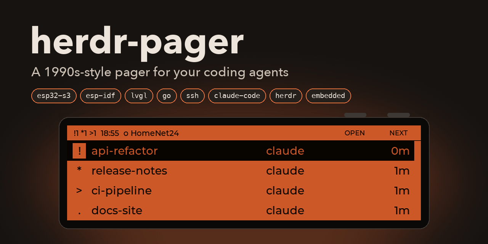
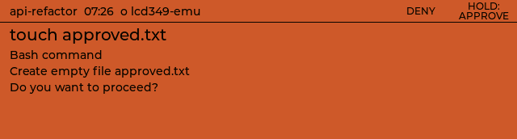
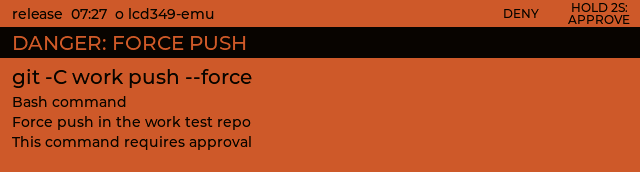
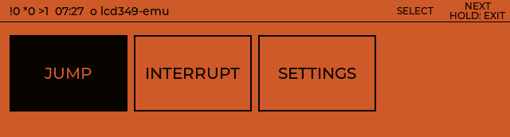
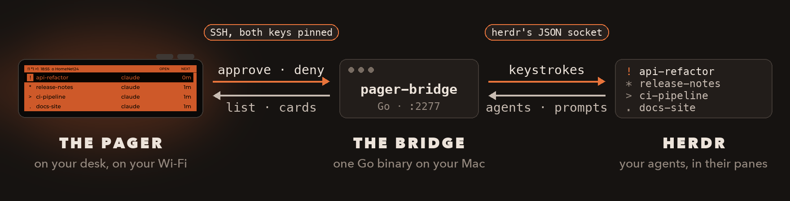
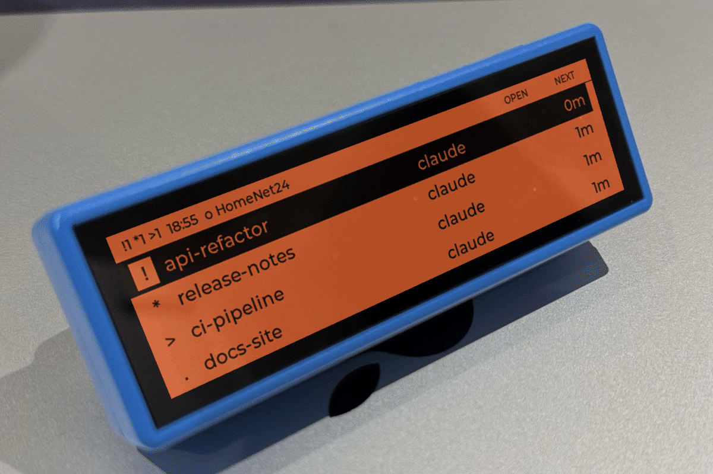

<div align="center">



**Beep beep. One of your agents needs you.**

A little screen for your desk that watches every coding agent in [herdr](https://github.com/herdrdev/herdr). When one stops to ask permission, it beeps, shows you the agent's own prompt, and lets you approve or deny it with a real button. No app, no cloud, no monthly plan.

[](https://github.com/MaverickHQ/herdr-pager/actions/workflows/ci.yml)
[](LICENSE)
[](https://github.com/MaverickHQ/herdr-pager/releases/latest)

[Why](#why-a-pager) · [What it does](#what-it-does) · [How it works](#how-it-works) · [Safety](#safety) · [Hardware](#the-hardware) · [Install](#install) · [Limitations](#limitations) · [The buttons](#the-buttons) · [Roadmap](#roadmap)

</div>

## Status

**v1.0 is the first published version: the desk pager.** It sits on the desk beside a Mac with Apple Silicon, on USB power and the Mac's Wi-Fi, and pages for Claude Code agents in herdr. Its maintainer uses it every day. Each version is built by CI from its tag, never on anyone's Mac: its release holds the bridge and the pager's firmware in one archive, with `SHA256SUMS`, a build attestation and libssh's source.

herdr-pager is a personal tool first (`docs/adr/0001`), published so that others can use it too. It isn't affiliated with herdr, Anthropic or Waveshare: its name says what it works with, not who made it.

## Why a pager

Run a handful of agents in herdr and you spend half the day waiting on one of them. The one that needs you is always in the pane you aren't looking at, stuck on a permission prompt, going nowhere until you notice.

In the 1990s, the answer to "someone needs you and you're busy" was a beeper on your belt. This is that, for agents. It sits beside your keyboard and stays quiet while everything is fine. When something isn't, it beeps. You glance over, read the command, press a button, and get back to what you were doing.

## What it does

- Keeps every herdr agent on one list, the most urgent at the top, each with its herdr tab (`<workspace>.<tab> <label>`) and its folder, so you know which pane a page came from.
- Pages you when an agent has been blocked for 3 s: it beeps, lights up and selects it. It reminds you every 5 minutes, and goes quiet by itself if you answer at the keyboard instead.
- Plays a short "ta-da" once when an agent finishes a turn in a pane you aren't watching, and selects its row. herdr calls every finished turn done, including one that ends by asking you something. DONE TONE in the settings turns the sound off.
- Shows the agent's own permission prompt, with what it asks to do on the first line: the command, the file path (an edit, a new file, or a read outside the folder), the URL it wants to fetch, or the MCP tool it wants to call (its server and tool, then each argument on a line of its own).
- Approves on a 1 s hold of BOOT, with a bar filling as you hold; let go early and nothing is sent. A press of PWR denies. Touch never approves anything.
- Flags the scary ones. Force pushes, forced deletes, `curl … | sh`, `sudo`, `DROP TABLE`, writes to `~/.ssh` or `.env`, reads or writes of files that hold secrets (private keys, the keychains, tokens and credentials, the bridge's own key), fetches of local addresses (`localhost`, the private ranges, the cloud metadata address) and more get a DANGER banner, their own tone, and a 2 s hold.
- Checks the prompt again just before any key goes out. If it changed, nothing is sent and the pager says SCREEN CHANGED.
- Brings an agent's pane to the front in herdr, or interrupts it while it's working, after asking.
- Notices when the Mac stops answering: it says so within 8 s of a press, and dials again.
- Comes in a deep orange, or a backlit green like the pagers of the day.

The list speaks in one-character codes, so no 911s to memorise:

| Code | Means |
|:---:|---|
| `!` | Blocked: it needs you |
| `*` | Done: its turn is over |
| `>` | Working |
| `?` | Unknown |
| `.` | Idle |

<table>
  <tr>
    <td></td>
    <td></td>
  </tr>
  <tr>
    <td align="center"><sub>A permission card. Each hint sits right under its button.</sub></td>
    <td align="center"><sub>Something risky: a banner, its own tone and a 2 s hold.</sub></td>
  </tr>
  <tr>
    <td></td>
    <td></td>
  </tr>
  <tr>
    <td align="center"><sub>An agent's menu: jump to it in herdr, interrupt it, or open the settings.</sub></td>
    <td align="center"><sub>The prompt moved before the keys went out, so nothing was sent.</sub></td>
  </tr>
</table>

<sub>Every screen in this README is the pager's real firmware, running in the lcd349-kit emulator against a fake herdr: the same harness that checks each screen against a golden image. The fake herdr has no tabs, so its rows show each agent's name and kind instead.</sub>

## How it works



Three pieces, one job each.

**The pager** (`firmware/`, C on ESP-IDF) is the part you touch. It dials the bridge over SSH and accepts only the host key it pinned when you paired it. It owns everything you see and press: the list, the cards, the tones, and the two buttons with their pocket-safety rules. Everything it does with the hardware goes through [lcd349-kit](#built-with), the board's SDK and emulator.

**pager-bridge** (`bridge/`, Go) is one binary on your Mac, and the only thing that talks to herdr's socket. It polls herdr once a second, sends the pager a snapshot whenever an agent changes and a card when you open one, cleans all agent text before it reaches the screen, and runs the danger rules. It has its own SSH server on port 2277, which lets in only the full public keys of the pagers you've paired. While you set the pager up, it also serves the setup page, on your Mac only.

**herdr** runs your agents. The pager never touches it. It sends verbs (approve, deny, jump, interrupt), one line of JSON each, never keystrokes or text, and the bridge decides which keys a verb means for that agent, from its keymap, after the stale check.

## Safety

Read this part before you trust it with anything.

**The pager is an attention device, not a security gate.** Any process in a herdr pane can already drive herdr's socket (`~/.config/herdr/herdr.sock`) and answer its own prompts, pager or no pager. A prompt-injected agent doesn't need the pager to approve itself. If you need a real gate, it belongs in the agent's own permission settings.

**No banner doesn't mean safe.** The danger rules are a reading aid, and they miss obfuscated commands and tools they don't know. Read the card's first line every time: it's always what the agent asks to do, the command, the file path, the URL (with the URL's host whole on the line under it), or the MCP tool's server and tool (with each argument on a line under it: up to 3, or the card says TOOL NOT READ). An MCP card names the tool as its server describes it, so a server you don't trust could name a tool misleadingly: only install MCP servers you trust.

What the pager does guard against:

| Risk | What stops it |
|---|---|
| **Approving the wrong prompt** | Each approval carries the card's `state_change_seq` and a hash of its text. Just before it sends any key, the bridge reads the agent again. If the prompt changed, it sends nothing and the pager shows SCREEN CHANGED. |
| **Approving by accident** | Approve takes a 1 s BOOT hold (2 s on a danger card) on a card that has been on screen for at least 500 ms. Touch never approves, denies or wakes the screen, and the press that wakes the screen does nothing else. There's no "always allow", and a verdict is never queued or resent. |
| **A question taken for a permission** | A prompt that isn't a permission prompt shows QUESTION - ANSWER AT KEYBOARD and takes no verdict. |
| **Approving a command it couldn't read** | The pager can approve a Bash command, a file edit or new file, a read outside the agent's folder, a web fetch, and an MCP tool call. If the bridge can't pick the command, file path, URL or MCP call out of a permission prompt (a URL is read only if its host is the one Claude Code names and it has no user name; the card shows that host whole on its second line, and a host longer than a line is not read; an MCP call is read only if its server and tool fit a line, it has 1 to 3 arguments (2 on a pager older than its bridge), each fits one line on screen, and no argument's name leaves fewer than 10 characters for its value, so a call with no arguments, more than 3, a value drawn over several lines, or a name that long says TOOL NOT READ), it holds escape codes or invisible characters the card can't show, or the bridge can't confirm that the option approve presses is the plain "Yes", the card says COMMAND NOT READ (or FILE NOT READ, URL NOT READ or TOOL NOT READ) and offers only DENY. Approve that one at the keyboard, and any other kind of prompt too: the bridge has never seen one, so its card offers at most DENY. |
| **Anyone else on the network** | Both ends check full keys: the bridge accepts only paired pagers, and the pager accepts only the host key it pinned. A pager can send only the keys in the bridge's keymap, never text. |
| **A web page driving the setup page** | The setup page listens on 127.0.0.1 only, on a random port, behind a one-time token, and checks every request's Host and Origin. It runs only while `pager-bridge setup` runs. It can't approve, deny or send keys, and it never shows a card. Pairing through it still takes BOOT on the pager. |

**The threat model, in brief** ([`docs/threat-model.md`](docs/threat-model.md) has every threat). What a pager sends is authenticated but not trusted: it can send only verbs, and the bridge picks the keys. What agents write is never trusted: it's cleaned before it reaches the screen, and never handed to a program. Pairing is trusted only once you've pressed BOOT on the pager. Your own files in `~/.config/herdr-pager/` are trusted. The risks it accepts, and leaves to you: it isn't a gate; the pager's storage isn't encrypted; a few milliseconds pass between the bridge's last read of a prompt and its keys; the danger rules miss what they don't know; 32 or more addresses flooding port 2277 can keep a pager out; and the bridge isn't signed with an Apple Developer ID, so its checksums and build attestations are what vouch for it.

**Lost your pager?** Run `pager-bridge devices revoke <name>`, and a running bridge closes its session within 2 s. Then change the passwords of the Wi-Fi networks it knew: its storage isn't encrypted, so whoever holds it could read them, and its key.

**Plug it only into computers you trust.** Its USB port is how it's flashed and paired, and a computer it's plugged into can read its whole flash, its device key and Wi-Fi passwords included. If it was plugged into one you don't trust, treat it as lost: revoke it (`pager-bridge devices revoke <name>`), factory reset it (hold BOOT and PWR 10 s, then BOOT), which makes it a new key, pair it again, and change the passwords of the Wi-Fi networks it knew. (Pair again alone keeps the old key.) Encrypting its flash is planned for a later version.

## The hardware



One board, no soldering: Waveshare's [ESP32-S3-Touch-LCD-3.49B](https://www.waveshare.com/esp32-s3-touch-lcd-3.49.htm?sku=32375), the version in Case B ([its documentation](https://docs.waveshare.com/ESP32-S3-Touch-LCD-3.49)). It's an ESP32-S3 with 8 MB of PSRAM behind a 3.49-inch, 172×640 IPS bar of a screen, with two buttons on top and a small speaker. Plug it into the Mac's USB-C and leave it there: the desk pager runs on USB power.

<sub>The board and the desk are real. The screen is the firmware's own screens from the emulator, laid onto the photo.</sub>

## Install

You need:

- **a Mac with Apple Silicon**, with [Homebrew](https://brew.sh) and current Command Line Tools, and [herdr](https://github.com/herdrdev/herdr) running your Claude Code agents. Homebrew installs herdr-pager as it would a build from source (there's no bottle yet), so with older tools it stops at "Your Command Line Tools are too outdated": update them from Software Update in System Settings, or with `xcode-select --install`;
- **Chrome or Edge**, for the setup page: it flashes the pager over WebSerial, which Safari and Firefox don't have;
- **the board**, and a USB-C cable that carries data, not only power;
- **a 2.4 GHz Wi-Fi network that the Mac is on too** ([Limitations](#limitations)).

```sh
brew install maverickhq/tap/herdr-pager
pager-bridge setup
```

`setup` opens the setup page in your browser, and prints its address in case the browser doesn't open. The page is served by the bridge, on your Mac only, for as long as `setup` runs. It takes you through each step in order, and shows what's happening as it happens: each step's output, the bridge's log and, while the pager is on USB, the pager's own log.

1. **The Mac:** it checks herdr's socket, the bridge's keys (it makes them if they're missing) and port 2277.
2. **Flash the pager** over USB, with the firmware that came with the bridge. A first install erases the board.
3. **Wi-Fi:** the networks the pager may join, up to four, in order of preference. A network's name must match exactly, and the page warns when one is close to, but not the same as, a network the Mac has saved: an iPhone's hotspot is named with a curly apostrophe (`Sam’s iPhone`). A password goes from the page to the bridge's memory and over USB to the pager, and nowhere else: never into a file, a log, the page's output or a URL. To check a phone's hotspot before you rely on it, see [a phone's hotspot](docs/guides/hotspot.md#test-it).
4. **Pair:** the page and the pager show the same two fingerprints, the pager's key and the bridge's. Check them, press BOOT on the pager, then confirm on the page. No password reaches the pager before you have done both.
5. **The firewall:** shown only if the Mac's firewall is on and blocks the bridge, with what to allow.
6. **Run at login**, through `brew services start herdr-pager`, so the bridge serves whenever you're logged in. Its log is `$(brew --prefix)/var/log/herdr-pager.log`.
7. **The first page:** the pager connected, with your agents on its list.

The page never approves, denies or sends anything to an agent, and never shows a card: verdicts stay on the pager. It stops 5 minutes after its last tab closes, or when you stop `setup` with Ctrl-C.

**Afterwards,** once a pager is paired, `pager-bridge setup` opens the same page on Manage: update a pager's firmware to the version shipped with the bridge (an update keeps its pairing), change its Wi-Fi networks, revoke it, turn run at login on or off, and run the bridge's checks. If the launchd agent runs another copy of the bridge, Run at login says which, and offers to switch it to this one. A first install erases a pager, so the page offers it only as a choice, for a new pager or one that was reset. `pager-bridge doctor` runs the same checks in the terminal, and says how to fix each one that fails. [`docs/bridge.md`](docs/bridge.md) has every command.

### Update

```sh
brew upgrade herdr-pager
brew services restart herdr-pager
pager-bridge setup            # then update the pager's firmware to match
```

Update the pager and the bridge together. A pager says in its hello how many lines of a card it draws, and a bridge sends a card of 4 lines (an MCP call with 3 arguments) only to a pager that says 4, so an older pager gets that call as TOOL NOT READ. If the Mac's firewall is on, `pager-bridge doctor` says whether it lets the new version through.

### Without Homebrew

Each [release](https://github.com/MaverickHQ/herdr-pager/releases) holds the archive `herdr-pager_<version>_darwin_arm64.tar.gz`, with `SHA256SUMS`, `THIRD_PARTY.md` and libssh's source. To check one and run it from its folder:

```sh
V=1.0.0; F=herdr-pager_${V}_darwin_arm64.tar.gz
curl -fLO https://github.com/MaverickHQ/herdr-pager/releases/download/v$V/$F
curl -fLO https://github.com/MaverickHQ/herdr-pager/releases/download/v$V/SHA256SUMS
shasum -a 256 -c --ignore-missing SHA256SUMS
gh attestation verify $F --repo MaverickHQ/herdr-pager    # optional: built by this repository's CI
tar -xzf $F && herdr-pager-$V/bin/pager-bridge setup
```

The bridge finds its firmware beside it, in `share/herdr-pager/firmware/`, so keep the folder together. It isn't signed with an Apple Developer ID: neither curl nor Homebrew marks what it downloads as quarantined, so macOS runs it, but a copy downloaded with a browser is quarantined and macOS refuses to open it. The checksums and the attestation are what vouch for it. Without Homebrew, run at login is the launchd agent in [`docs/bridge.md`](docs/bridge.md#run-it-at-login).

### With Claude Code

```
/plugin marketplace add MaverickHQ/herdr-pager
/plugin install herdr-pager@herdr-pager
```

Then ask Claude Code to check your pager. Its `herdr-pager` skill checks the install, runs `pager-bridge doctor --json` and explains each check that fails, opens the setup page for anything that needs you, and explains the pager's screens and codes. It never asks for a Wi-Fi password, and never pairs or revokes a pager itself: you do those on the page. There's no MCP server, so the agents the pager watches get no tool to revoke it.

## Build from source

You need what [Install](#install) lists, without Homebrew, and:

- **Go 1.26**;
- **ESP-IDF 5.5**. `firmware/main/idf_component.yml` takes [lcd349-kit](https://github.com/MaverickHQ/lcd349-kit) from its public repository at a tag, and the component lock files (`firmware/dependencies.lock.*`) pin its commit and every other component; the first build fetches them.

### 1. Build the bridge and give it an identity

```sh
cd bridge && go build -o ../bin/pager-bridge ./cmd/pager-bridge && cd ..
bin/pager-bridge init
```

`init` creates `~/.config/herdr-pager/` with the bridge's SSH host key, `config.toml` and an empty `devices.toml`. It prints the host key's fingerprint and the listen address (`0.0.0.0:2277`). Running it again changes nothing. It warns if herdr isn't running; start herdr, and the bridge connects when it serves.

### 2. Let it through the macOS firewall

If the firewall is on (System Settings → Network → Firewall), allow the binary, or the pager's calls never get through:

```sh
sudo /usr/libexec/ApplicationFirewall/socketfilterfw --add "$PWD/bin/pager-bridge"
sudo /usr/libexec/ApplicationFirewall/socketfilterfw --unblockapp "$PWD/bin/pager-bridge"
```

A rebuild makes a new binary, so allow it again after each `go build`.

### 3. Run the bridge

```sh
bin/pager-bridge serve
```

It logs to stderr and runs until Ctrl-C. To run it at login instead, install the launchd agent (`docs/bridge.md` §Run it at login). `bin/pager-bridge status` shows whether it's running, herdr's state and which pagers are connected.

### 4. Build and flash the firmware

With ESP-IDF's environment loaded (`. $IDF_PATH/export.sh`) and the board on USB:

```sh
idf.py -C firmware set-target esp32s3
idf.py -C firmware -p /dev/cu.usbmodemXXXX build flash
```

`ls /dev/cu.usbmodem*` finds the port. A pager that has never been paired starts in pairing mode and shows PAIR VIA USB. Flash the firmware from the same commit as the bridge ([Update](#update) says why).

### 5. Pair the pager

Pairing is over USB only. Give the pager a name and the Wi-Fi network's name. Type the password at the hidden prompt: it's read from stdin, and never printed or logged.

```sh
read -rs pass && printf '%s\n' "$pass" | bin/pager-bridge provision \
    --port /dev/cu.usbmodemXXXX --name pager-01 --wifi-ssid "Home" --wifi-pass-stdin; unset pass
```

1. A pager that has been paired before must be put back in pairing mode now: choose **Pair again** in its global menu. `provision` waits up to 120 s for it, and finds a pager already showing PAIR VIA USB at once.
2. `provision` prints two fingerprints, the pager's key and the bridge's, and sends the pager the bridge's key: nothing secret. Check that the pager shows the same two.
3. Press **BOOT** on the pager within 30 s (PWR cancels). Then `provision` asks on the terminal whether they match; answer `y` within 30 s, and only then does it send the Wi-Fi password. The pager is added to `devices.toml` once it has saved it.

The pager joins the Wi-Fi network and dials the bridge at `<this Mac's LocalHostName>.local`; `--host <ip>` overrides that. Up to four networks can be saved, highest priority first (`docs/bridge.md` §`provision`: pair a pager).

A network's name must match exactly, apostrophes included. An iPhone's hotspot is usually named with a curly apostrophe (`Sam’s iPhone`), which a straight one never matches. `provision` warns when a name is close to, but not the same as, one this Mac has saved. To copy the exact name, `networksetup -listpreferredwirelessnetworks en0` lists them.

For an iPhone hotspot, turn on **Maximize Compatibility**: the pager joins only 2.4 GHz networks. An iPhone shows its hotspot to other devices only while **Settings → Personal Hotspot** is open, so keep that screen open until the pager has joined. The Mac must be on the same hotspot.

**The setup page from a source build.** `bin/pager-bridge setup` serves the same page. Given `--firmware <dir>`, a folder laid out as the release's `share/herdr-pager/firmware/` (ESP Web Tools' `manifest.json` and the images it names), it flashes your own build; without firmware beside it, the page says how to get it.

## Limitations

- **macOS on Apple Silicon only.** The bridge's serial port, firewall and login-item code is macOS's, and the release's bridge is built for arm64 only.
- **Claude Code's keymap only, for now.** The bridge knows how to read and answer Claude Code's prompts. Any other agent in herdr still shows on the list, and you can jump to it, but its card offers no approve or deny. [`CONTRIBUTING.md`](CONTRIBUTING.md) says how a keymap for another agent is captured.
- **2.4 GHz Wi-Fi only.** The ESP32-S3 can't join 5 GHz. A dual-band network with one name works while its 2.4 GHz band is on; a 5 GHz-only network never will. On an iPhone's hotspot, turn on Maximize Compatibility.
- **The pager must share a network with the Mac.** It dials the bridge directly, on port 2277, and has no other way to reach it: no relay, no cloud and no tailnet (`docs/adr/0005`). A network that keeps its devices from reaching each other, as many guest networks do, won't work either.
- **On USB power.** The desk pager is meant to stay plugged in. With a battery fitted it keeps running when unplugged, and says ON BATTERY, but it doesn't save power or turn itself off yet.
- **Flashing from the page needs Chrome or Edge** (WebSerial).
- **The pager's storage isn't encrypted** ([Safety](#safety)).

## The buttons

Two buttons, both on the top edge: BOOT on the right, PWR beside it. Whatever a button does right now is written on screen, right under it.

| On | Press | Does |
|---|---|---|
| Anything, screen off | either button | Wakes the screen, and nothing else |
| The list | BOOT | Moves to the next agent |
| The list | PWR | Opens the agent's card. With no link to the bridge, it says X NO LINK, and on an empty list it shows device info |
| The list | hold BOOT 1.5 s | Opens the selected agent's menu: JUMP (bring its pane to the front in herdr), INTERRUPT (while it's working) and SETTINGS, the global menu (silent mode, volume, the done tone, brightness, colour, device info, Pair again). With no agents, it opens the global menu |
| The menu | BOOT, PWR, hold BOOT 1.5 s | Next item, select, close |
| A permission card | hold BOOT 1 s (2 s on DANGER) | Approves: a bar fills under BOOT; let go early and nothing is sent |
| A permission card | PWR | Denies |
| A permission card | BOOT | Back to the list, with no verdict |
| A COMMAND NOT READ, FILE NOT READ, URL NOT READ or TOOL NOT READ card | PWR, or BOOT | Denies, or back to the list. No hold approves it: approve it at the keyboard |
| A question card | BOOT or PWR | Back to the list (answer it at the keyboard) |
| The list or a card | hold PWR 2 s | Silent mode on or off |
| Any time | hold BOOT and PWR 10 s | Asks FACTORY RESET? (BOOT resets, PWR cancels) |

Interrupt asks first, with PWR meaning yes, so a reflexive BOOT press can never interrupt. When a page comes in, the list's selection moves to the paged agent (unless it's already on a blocked one), so one PWR press opens its card. If the cable comes out, the status bar shows ON BATTERY: the desk pager is meant to run on USB power.

## By the numbers

Measured on the board and the Mac, not guessed. These are from the last full run of the board checks, on 27 October 2026, on the maintainer's board on home Wi-Fi, and the bridge's footprint from 26 October; [`docs/measurements.md`](docs/measurements.md) has how, when, every run and every sample.

| | Budget | Measured |
|---|---|---|
| **N1** Agent blocked → pager beeps (p95 of 20) | ≤ 6 s | **3.3 s**, of which 3 s is a deliberate wait, so a brief block doesn't page you |
| **N2** Hold completes → keys sent to herdr (p95 of 20) | ≤ 1.5 s | **0.13 s** |
| **N3** Bridge restarted → pager reconnected (5 restarts) | ≤ 35 s | **1.2 s** at worst, with the list back 0.09 s later |
| **N3** herdr restarted → list back on the pager (5 restarts of a fake herdr) | ≤ 2 s | **0.95 s** at worst: the bridge's 1 s poll |
| **N7** Reset → connected, list on screen (5 resets) | ≤ 15 s | **9.6 s** at worst |
| **N4** Bridge memory and CPU, 10 agents | ≤ 40 MB, ≤ 1 % | **25.8 MiB** at most, **0.77 %** of one core on average |
| **N12** A newcomer, from `brew install` to the first page | ≤ 15 minutes | Not measured yet |

Two things these don't show. Before the pager tried a refused Wi-Fi join again at once, two boots that met two refusals in a row from the access point took 16.4 s and 16.2 s; the run since met no refusal, so that case hasn't been timed again. And the firmware has gained the fetch and MCP cards and a security pass since that run; the board checks haven't been run on it yet.

## Roadmap

| Version | What | Where it stands |
|---|---|---|
| **v1.0** | **The desk pager**: on the desk, on USB power and the Mac's Wi-Fi, for Claude Code agents in herdr; the setup page, Homebrew and the Claude Code plugin | This version |
| A later version | **The portable pager**: off the desk, on its battery and a phone's hotspot; the battery level, power off and sleep, snooze and quiet hours, moving through the list by touch, an optional vibration motor, and the pager's own usage numbers | Planned |
| A later version | An encrypted flash and a secure download mode, so that neither a computer it's plugged into nor whoever holds it can read its key and Wi-Fi passwords. Each is a one-way change to the board's eFuses, so it's being thought through first | Under consideration |
| Optional | A typed approve call in herdr itself, so that approvals stop depending on keystrokes; the bridge would use it wherever herdr offers it | Not started: a proposal to herdr |

Not planned: reaching the pager away from the Mac's network, over a tailnet (`docs/adr/0005`). [`CHANGELOG.md`](CHANGELOG.md) lists what each version changed.

## Develop

| What | Command |
|---|---|
| The bridge's suite (a temp HOME and a fake herdr; never yours) | `cd bridge && go vet ./... && go test ./...` |
| The firmware's app core on the host (Unity, a fake clock) | `firmware/test_host/run.sh` |
| The firmware in the kit's emulator, every screen against its golden image | `lcd349 build -C firmware && cd bridge && PAGER_EMUTEST=1 go test -timeout 30m ./emutest/...` |
| A fake herdr to run the bridge against | `cd bridge && go run ./cmd/fakeherdr --socket <path> [--scenario <file>]` |
| The release's packer and checker | `cd tools/release && go test ./...` |
| The board checks and measurements (flashes test builds; `docs/measurements.md` says what they need) | `cd tools/measure && PAGER_MEASURE=1 go test -timeout 90m ./...` |
| This README's images, from the firmware in the emulator (Pillow, macOS's fonts) | `cd bridge && PAGER_EMUTEST=1 PAGER_DEMO=1 go test -run TestDemo -count=1 ./emutest/ && cd .. && python3 tools/media/compose.py` |

CI runs the first three on every push and pull request: the bridge's suite and the emulator on macOS, and the host tests in the pinned ESP-IDF container (`.github/workflows/ci.yml`). A tag runs `.github/workflows/release.yml`, which builds the published version.

```
bridge/            pager-bridge (Go): herdr client, cards and danger rules, SSH server, pairing, the setup page
  cmd/             pager-bridge and fakeherdr
  keymaps/         which keys each verb sends, per agent kind (Claude Code's so far)
  emutest/         the firmware driven in the emulator; golden screens; the README's demo
firmware/          the pager (C, ESP-IDF, lcd349-kit)
  main/app/        the app core: model, alerts, input rules, menus (host-tested)
  main/ui/         the screens
  main/net/        the SSH link
  main/platform/   the glue to lcd349-kit: settings, Wi-Fi, fonts, the colour themes
  scenarios/       the golden screens
plugin/            the Claude Code plugin and its setup skill (.claude-plugin/ is its marketplace)
contrib/           the Homebrew formula's template and the launchd agent
tools/release/     the release's packer, checker and formula writer
tools/measure/     the board checks and measurements
tools/media/       the README's images, composed from the emulator's screens
docs/              the guides, the bridge's guide, measurements, the threat model and the decisions (adr/)
docs/design/       the requirements and the design: the whole product's, and the desk pager's
```

Issues are welcome; pull requests aren't taken yet. This repository is published from a private working copy, one commit per version, so a pull request here can't be merged: [`CONTRIBUTING.md`](CONTRIBUTING.md) says what to send instead.

## Documentation

- The guides: [pairing](docs/guides/pairing.md) (and pairing again, revoking, factory reset), [the hardware](docs/guides/hardware.md), [a phone's hotspot](docs/guides/hotspot.md) and [the danger rules](docs/guides/danger-rules.md) (and writing your own).
- [`docs/bridge.md`](docs/bridge.md): the bridge guide, with every command, its files and settings, pairing, logs and running it at login.
- [`docs/measurements.md`](docs/measurements.md): the measured latencies and footprint.
- [`docs/threat-model.md`](docs/threat-model.md): what it defends against, how, and the risks it accepts.
- [`docs/design/`](docs/design/): the requirements and the design, with the protocol and the threat model: [the product's](docs/design/requirements.md) ([design](docs/design/design.md)) and [the desk pager's](docs/design/desk-pager/requirements.md) ([design](docs/design/desk-pager/design.md)).
- [`GLOSSARY.md`](GLOSSARY.md) and [`docs/adr/`](docs/adr/): the terms and the decisions.
- [`CHANGELOG.md`](CHANGELOG.md): what changed in each version.
- [`CONTRIBUTING.md`](CONTRIBUTING.md): issues, and the keymap guide.
- [`SECURITY.md`](SECURITY.md): how to report a security problem privately.
- [`THIRD_PARTY.md`](THIRD_PARTY.md): the third-party software and its licences.

## Built with

- [herdr](https://github.com/herdrdev/herdr), the terminal agent console the pager watches. herdr-pager talks to it only through its local JSON socket.
- [lcd349-kit](https://github.com/MaverickHQ/lcd349-kit), a companion SDK, emulator and test harness for the Waveshare 3.49" board, built alongside this project. Everything the firmware does with the hardware goes through it.
- [ESP-IDF](https://github.com/espressif/esp-idf) 5.5 and [LVGL](https://lvgl.io) 9.
- [libssh](https://www.libssh.org) 0.12.2 on the board ([`david-cermak/libssh`](https://components.espressif.com/components/david-cermak/libssh), LGPL-2.1, linked as a separate library; `docs/adr/0004`), and Go's [`x/crypto/ssh`](https://pkg.go.dev/golang.org/x/crypto/ssh) on the Mac.

## Licence

Apache-2.0: see `LICENSE`. The third-party software it uses, and their licences, are in `THIRD_PARTY.md`. On the board, libssh is LGPL-2.1, linked as a separate library: each release carries libssh's source, and if you hand someone a firmware binary, hand them this source with it (`docs/adr/0004`).

Found a security hole? `SECURITY.md` says how to report it privately.

herdr-pager isn't affiliated with herdr, Anthropic or Waveshare.
