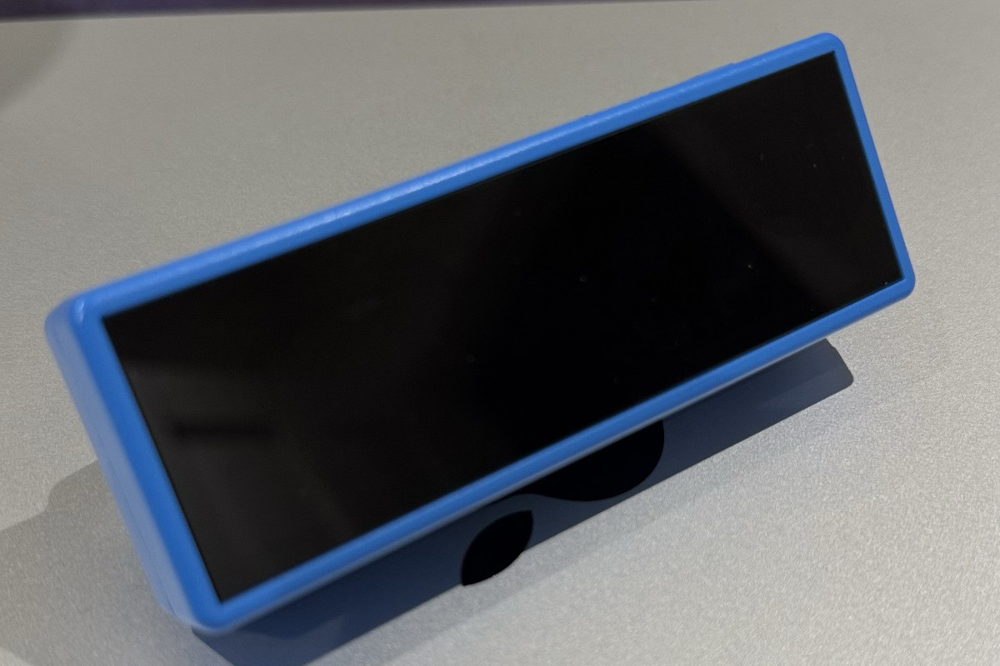

# The hardware

herdr-pager runs on one board, with no soldering: Waveshare's **ESP32-S3-Touch-LCD-3.49**. Buy the **B** listing, which is the same board in Case B with a Li-Po battery ([Waveshare's store page](https://www.waveshare.com/esp32-s3-touch-lcd-3.49.htm?sku=32375), [its documentation](https://docs.waveshare.com/ESP32-S3-Touch-LCD-3.49)). You also need a USB-C cable that carries data, not only power.

## What's on it, and what the pager uses

| Part | What it is | The pager |
|---|---|---|
| Chip | ESP32-S3R8: 240 MHz, 8 MB PSRAM, 16 MB flash | Runs the firmware |
| Screen | 3.49-inch IPS, 640 × 172 in landscape, about 85 × 23 mm | The list, the cards, the menus |
| Buttons | BOOT and PWR, on the top edge | Everything you do: [the README's button table](../../README.md#the-buttons) |
| Speaker | A small speaker on the MX1.25 header, driven by an ES8311 codec | The page, the reminder, the done and danger tones |
| Wi-Fi | 2.4 GHz only, on-board antenna | The link to the bridge |
| USB-C | USB Serial/JTAG: no driver needed on a Mac | Power, flashing, pairing and the pager's log |
| Battery | A 3.7 V Li-Po on its MX1.25 header, in Case B | Keeps it running unplugged, and the status bar says ON BATTERY |
| Touch | Capacitive, built into the screen | Not used: touch never does anything on the desk pager |
| Microphones, motion sensor, clock chip, TF card, Bluetooth | On the board | Not used |

Case B is 98.5 × 34.8 × 22.8 mm. There are two revisions of the board, V1 and V2; herdr-pager has been built and tested on V2. Everything the firmware does with the hardware goes through [lcd349-kit](https://github.com/MaverickHQ/lcd349-kit), whose [hardware page](https://github.com/MaverickHQ/lcd349-kit/blob/main/docs/hardware.md) lists every board fact with its source.

## The buttons

In landscape, with the USB-C port on the right, both buttons are at the right-hand end of the top edge: **BOOT** rightmost, **PWR** beside it. Whatever a button does at that moment is written on screen right under it. The board has no other button the pager uses.

**Don't hold BOOT while you plug the pager in.** Held through a reset, BOOT starts the chip's download mode instead of the firmware: the screen stays dark and nothing runs. Unplug it and plug it in again without touching BOOT. For the same reason, no button combination of the pager's is read while it starts.

That same download mode is the way out if flashing ever fails: hold BOOT while you plug the pager in, then flash it (the setup page, or `idf.py … flash`), then unplug it and plug it in again.

## Power

The desk pager is meant to stay on USB, plugged into the Mac or a charger. With the battery fitted it keeps running when unplugged, and says ON BATTERY in the status bar, but it doesn't yet show the battery's level, save power or turn itself off: those come with the portable pager, in a later version.

## Wi-Fi

The ESP32-S3 has no 5 GHz radio. A dual-band network with one name works while its 2.4 GHz band is on; a 5 GHz-only network never will. A phone's hotspot must offer 2.4 GHz: [the hotspot guide](hotspot.md). The pager must share its network with the Mac: it dials the bridge directly (`docs/adr/0005`).

## Its storage, and where to plug it in

The pager's flash isn't encrypted. Its device key and its Wi-Fi passwords are readable by anyone holding the board, and by any computer it's plugged into over USB. Plug it only into computers you trust; the README's [Safety](../../README.md#safety) section and [the pairing guide](pairing.md#if-it-was-lost-or-plugged-into-a-computer-you-dont-trust) say what to do if it's lost or was plugged in somewhere you don't trust. Encrypting the flash is planned for a later version.

## Device info

The global menu's device info (or PWR on an empty list while the link is down) shows:

| Line | What |
|---|---|
| The title | The pager's name, as you paired it |
| `FW … STARTED: …` | The firmware's version, and why it last started: POWER ON, RESTART, CRASH, BROWNOUT or RESET. NO SOUND if its audio failed at start-up |
| `DEV SHA256:…` | The pager's own key's fingerprint |
| `HOST SHA256:…` | The bridge's host key it pinned |
| `IP … BRIDGE …:2277` | Its address on Wi-Fi, and the address it dials |

The version matches `pager-bridge --version` when the pager and the bridge come from the same published version.
